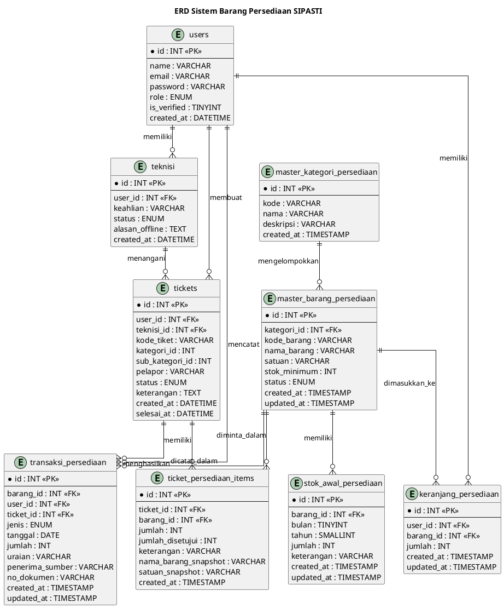

# ERD Sistem Barang Persediaan SIPASTI

Diagram berikut menggambarkan entitas utama pada modul persediaan, permintaan barang, teknisi, dan transaksi stok.

## Catatan

- `ticket_persediaan_items` adalah tabel detail yang menghubungkan permintaan dengan barang.
- `jumlah_disetujui` menyimpan jumlah barang yang disetujui teknisi.
- `keterangan` menyimpan alasan penyesuaian jika jumlah disetujui tidak sama dengan yang diminta user.
- Transaksi `keluar` dapat ditautkan ke tiket melalui `ticket_id`.
- Pada alur saat ini, keranjang digunakan melalui session; `keranjang_persediaan` disediakan sebagai tabel keranjang/cadangan.
