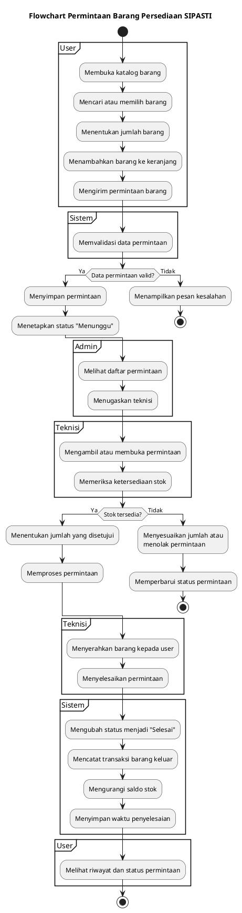

# Flowchart Sistem Barang Persediaan SIPASTI

Flowchart berikut menggambarkan alur utama permintaan barang persediaan, mulai dari user memilih barang sampai stok diperbarui setelah permintaan selesai.

## Ringkasan alur

1. User memilih barang dan jumlah yang dibutuhkan.
2. User mengirim permintaan melalui keranjang.
3. Sistem memvalidasi dan menyimpan permintaan dengan status **Menunggu**.
4. Admin melihat permintaan dan menugaskan teknisi.
5. Teknisi memeriksa stok, menentukan jumlah yang disetujui, lalu memproses permintaan.
6. Setelah barang diserahkan, teknisi menyelesaikan permintaan.
7. Sistem mencatat transaksi **barang keluar** dan mengurangi saldo stok.
8. User dapat melihat status **Selesai** pada riwayat permintaan.

Jika data permintaan tidak valid, sistem menampilkan pesan kesalahan. Jika stok tidak mencukupi, teknisi dapat menyesuaikan jumlah yang disetujui atau menolak permintaan.
