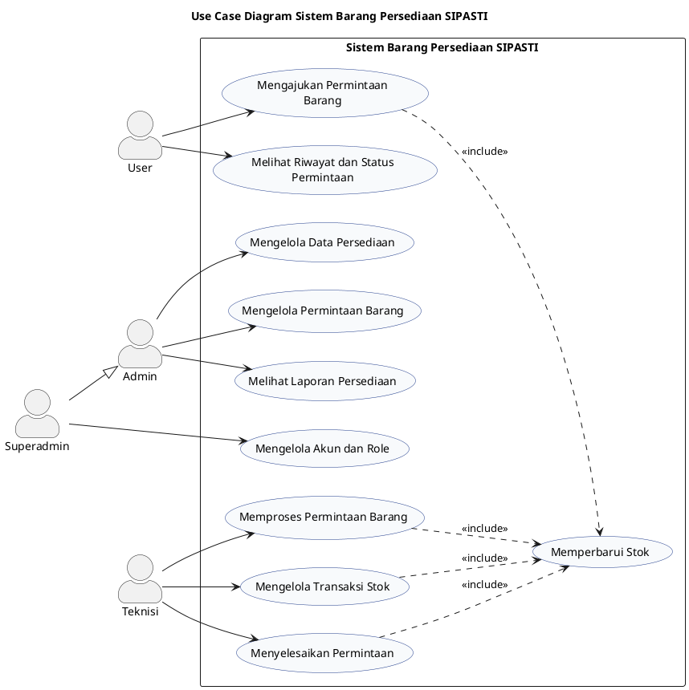

# Use Case Diagram Sistem Barang Persediaan SIPASTI

Diagram berikut menggambarkan fungsi utama User, Admin, Superadmin, dan Teknisi pada sistem barang persediaan SIPASTI secara ringkas.

## Catatan

- `Superadmin --|> Admin` berarti Superadmin mewarisi hak akses Admin.
- **User** mengajukan permintaan dan melihat status permintaan.
- **Admin** mengelola data persediaan, permintaan barang, dan laporan.
- **Superadmin** mengelola akun serta role pengguna.
- **Teknisi** memproses permintaan, mengelola transaksi stok, dan menyelesaikan permintaan.
- `<<include>> Memperbarui Stok` menunjukkan bahwa proses permintaan atau transaksi dapat memperbarui stok.
